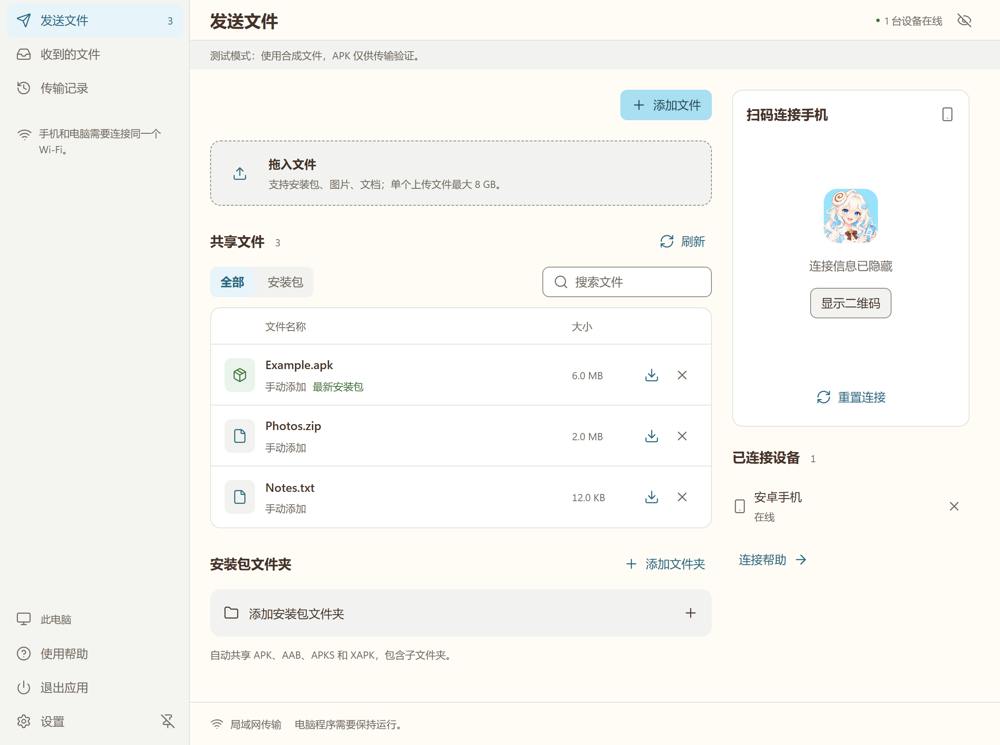
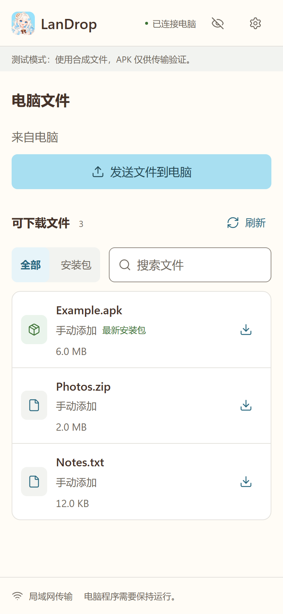

<h1 align="center">LanDrop</h1>

English | <a href="./README.zh-CN.md">简体中文</a>

Transfer files between a Windows PC and an Android phone over your local network using the phone's browser.

[Download for Windows](https://github.com/icelemon233/LanDrop/releases/latest) · [Build from source](./docs/development.md)

Windows 10/11 x64. The interface is in Simplified Chinese.

  <picture>
    <source media="(prefers-color-scheme: dark)" srcset="./docs/readme/desktop-dark.png">
    
  </picture>
  <picture>
    <source media="(prefers-color-scheme: dark)" srcset="./docs/readme/phone-dark.png">
    
  </picture>

*Synthetic files in paired desktop and mobile-browser test sessions. Connection details are hidden.*

## File transfers

- Connect by scanning the PC's QR code with your phone.
- Upload multiple files with progress and cancellation, up to 8 GB per file. Duplicate names get a new filename.
- Watch a build folder for APK, AAB, APKS and XAPK files, including subfolders. AAB files cannot be installed directly.
- Share original files or drop files into the window to copy them into the outgoing folder. Removing a share keeps the original file.

## Get started

1. Run the Windows installer and open **LanDrop**. Python and a phone app are unnecessary. The installer sets up WebView2 if it is missing, which requires an internet connection.
2. Connect the PC and phone to the same local network, then add files on the PC.
3. Scan the QR code and open the page in your phone's browser. Select a file to download or choose **发送文件到电脑** (Send files to PC) to upload.

Closing the desktop window sends it to the tray by default and keeps transfers running. Choose **退出应用** (Exit app) to stop the app and unfinished transfers.

## Connection and data

Transfers use local HTTP, so use a trusted network. The QR code contains a temporary pairing credential. **重置连接** (Reset connection) revokes connected phone sessions.

If the phone cannot connect, check guest Wi-Fi isolation, VPN routing and Windows Firewall. With multiple adapters, select the PC address below the QR code. If you scan with WeChat, open the link in the system browser.

Updates and uninstallation preserve received files and shared-folder settings. Transfer history keeps the latest 100 entries for the current run. Theme preferences stay on the current device.

The Windows package is unsigned. See the [usage guide (Chinese)](./docs/使用说明.txt) and [third-party notices](./THIRD_PARTY_NOTICES.txt).
