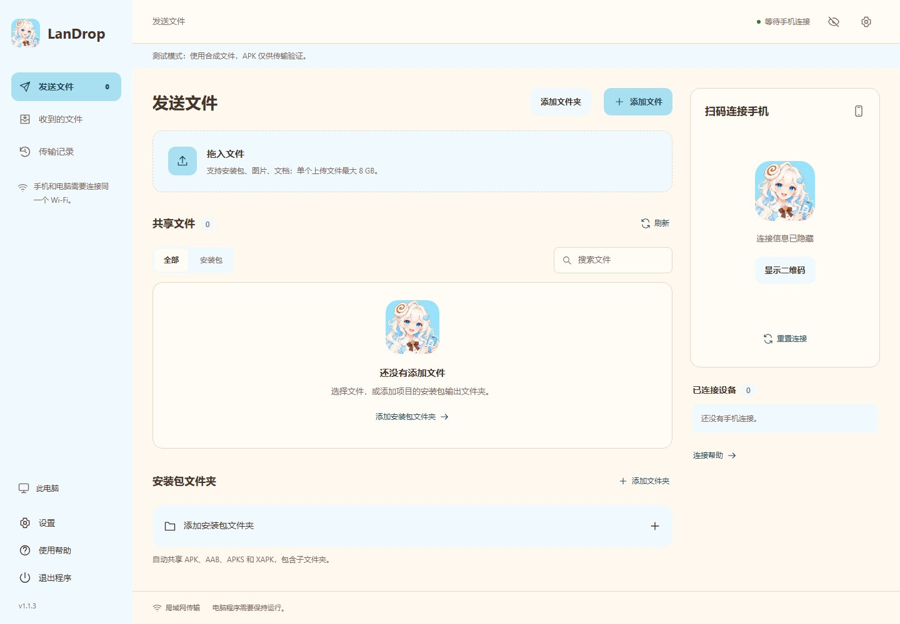

# LanDrop

[English](README.md) | 简体中文

在局域网内互传 Windows 电脑与安卓手机上的文件。用手机扫描电脑显示的二维码，通过浏览器连接。

截图使用独立测试实例，连接信息已隐藏。

[下载 Windows 版](https://github.com/icelemon233/LanDrop/releases/latest)

## 连接

支持 Windows 10/11 x64，无需安装 Python 或手机应用。

1. 运行安装程序，从桌面或开始菜单打开 **LanDrop**。
2. 电脑和手机连接同一个局域网。
3. 在电脑上添加文件，用手机扫描二维码。
4. 点击文件下载，或选择“发送文件到电脑”上传文件。

## 文件

- 分享文件，或添加安装包文件夹，自动共享 APK、AAB、APKS 和 XAPK，包含子文件夹。AAB 不能直接安装。
- 支持多文件上传、进度显示与取消，单个文件最大 8 GB；同名文件会另存。
- 系统文件选择直接共享原文件；拖入网页会复制到待发送目录。移除共享不会删除原文件。

## 数据与更新

升级和卸载保留收到的文件与共享文件夹设置。传输记录只保留本次运行最近 100 条，外观偏好保存在浏览器中。

关闭网页后，服务仍会运行；点击“退出程序”停止服务。升级前关闭文件选择窗口，允许安装程序请求正常退出；未完成的传输会中断。

## 连接问题

文件通过局域网 HTTP 传输，请使用信任的网络。二维码包含临时连接凭据，“重置连接”会撤销手机访问。

手机无法连接时，检查访客 Wi-Fi 隔离、VPN 和 Windows 防火墙。电脑有多个网卡时，在二维码下方切换地址。微信扫码后，通过菜单选择“在浏览器打开”。

详见[使用说明](docs/使用说明.txt)、[构建说明](docs/development.md)和[第三方声明](THIRD_PARTY_NOTICES.txt)。Windows 安装包目前尚未签名。

开发者：Cinna。
